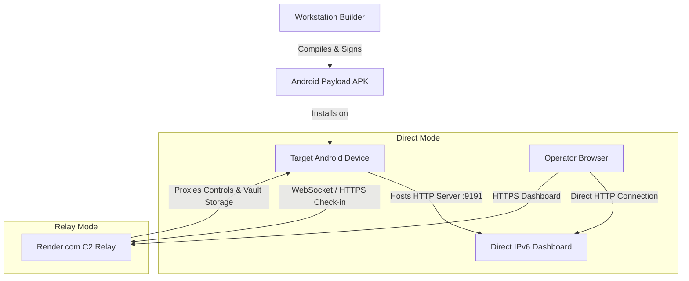

# 08 ⏤ System Architecture & Component Map

> High-level architecture map showing how the Android payload, workstation builder, and cloud relay interact.

---

## 🏗️ System Overview

Lab-RATS consists of three core components:

1. **Android Payload App:** Serves as the device-side engine. Hosts a local C2 web server on port `9191`, manages stealth decoys, processes C2 commands, and exfiltrates telemetry.
2. **Workstation Builder (`apk-builder`):** Command-line wizard (`build.sh` / `build.bat`) that configures app branding, package IDs, C2 URLs, signs the APK with Gradle, and packages weaponized carrier files (PDFs, MP4s, calendar invites).
3. **Cloud Relay Backend (`c2-server`):** Optional Node.js / Express relay server hosted on Render.com or VPS. Proxies commands and stores exfiltrated media when direct IPv6 connections are blocked by carrier firewalls.

---

## 📊 Data Flow Diagram

---

## 🛡️ Security & Watchdog Layers

- **Decoy Launcher Activity:** Displays decoy persona (Play Protect, Calculator, Weather, System Update) upon first launch.
- **Accessibility Watchdog:** Ensures persistence across system reboots and defends against unauthorized force-stop attempts.
- **Device Admin Elevation:** Disables standard force-stop and uninstallation triggers.
